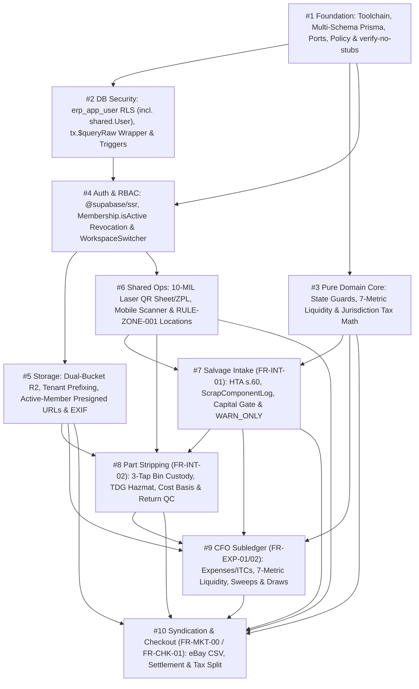

# Phase 1A Implementation Handoff, Regulatory Traceability & Open Decisions (`opsclawd/inventory`)

> **Document Role & Scope (`ADR-0006` `FIX 08`):** This is the **durable, version-controlled repository implementation handoff** for Phase 1A (`Issues #1`–`#10`). It consolidates regulatory/tax traceability, requirement-to-issue mapping, unresolved business/site prerequisites, and the Phase 1A execution frontier in one canonical root file (paired with the machine-checkable agent readiness policy in [`AGENTS.md`](./AGENTS.md)).
>
> **Distinction from Temporary Session Handoffs:** Temporary session handoffs generated via [`.agents/skills/handoff/SKILL.md`](./.agents/skills/handoff/SKILL.md) live outside the repository in `/tmp/handoff-*.md` for ephemeral agent-to-agent context transfers and must link back to [`ARCHITECTURE.md`](./ARCHITECTURE.md), [`PRD.md`](./PRD.md), [`DOMAIN-RULES.md`](./DOMAIN-RULES.md), [`GLOSSARY.md`](./GLOSSARY.md), [`AGENTS.md`](./AGENTS.md), and this document rather than duplicating normative specifications.

---

## Section 1 — Regulatory & Tax Obligation Register

> **Critical Governance Principle:** **Legal applicability** and **software enforcement mode** (`HARD_BLOCK` vs. `WARN_ONLY`) are independent concepts. Operating Phase 1A in `complianceEnforcementMode = "WARN_ONLY"` (`ADR-0003`) prevents ERP workflow deadlocks so physical custody and financial records remain 100% accurate, **but does not make any mandatory provincial or federal legal requirement optional**. Unverified business licences or site approvals are explicitly classified below and in [Section 3](#section-3--open-business-and-site-decisions) rather than treated as completed facts.

| Obligation | Source | Effective Date | Business | Applicability | Enforcement Mode | Rule References | Implementation Phase |
| :--- | :--- | :--- | :--- | :--- | :--- | :--- | :--- |
| **Ontario EASR End-of-Life Vehicle (ELV) Registration & Fluid Depollution** (`>= 3` ELVs stored/processed in 12 months; fluid drainage prior to outdoor pad storage or crushing) | Ontario *Environmental Protection Act*, R.S.O. 1990, c. E.19; **`O. Reg. 85/16`** (*End-of-Life Vehicles*) | In force (amended current consolidation) | Salvage (`ORG_SALVAGE_EXPORT`) | **Mandatory** once statutory ELV threshold/activity is triggered; site EASR number currently **Unverified** (`DEC-03`) | `WARN_ONLY` in Phase 1A (`EASR_THRESHOLD_EXCEEDED_NO_REG`, `COMPLIANCE_WARNING_UNDRAINED_FARM`); configurable to `HARD_BLOCK` (`STRICT_BLOCK`) | `RULE-ENV-001`, `RULE-ZONE-001`, `FR-INT-01`, `FR-INT-02`, `ADR-0003`, `ADR-0004` | **Phase 1A** (`#1`, `#3`, `#7`, `#8`) |
| **Ontario Statutory Garage & Wrecking Yard Register** (record VIN, make/model, colour, purchase date, seller name/address, UVIP/RIN verification, and catalytic converter/scrap disposition) | Ontario *Highway Traffic Act*, R.S.O. 1990, c. H.8, **s. 60** | In force | Salvage (`ORG_SALVAGE_EXPORT`) | **Mandatory** for motor vehicles/parts bought or wrecked | `WARN_ONLY` in Phase 1A (`MISSING_HTA_S60_DOCS`, `UNRECONCILED_CATALYTIC_CONVERTER`); configurable to `HARD_BLOCK` | `FR-INT-01`, `FR-INT-02`, `ADR-0003` | **Phase 1A** (`#1`, `#7`, `#8`) |
| **Ontario DriveON Digital Safety Standards Certificate (SSC) & Structural Inspection** (10-day re-inspection window; 36-day SSC validity for retail plate transfer) | Ontario *Highway Traffic Act*, **`O. Reg. 376/02`** & Reg. 601 (*Motor Vehicle Inspection Stations* / DriveON) | Digital DriveON regime active 2024–2025+ | Salvage (`ORG_SALVAGE_EXPORT`) | **Conditional** (applies only when transferring roadworthy retail vehicles requiring an SSC) | `WARN_ONLY` timer tracking in Phase 1A (`driveOnInspectionFailedAt`, `driveOnSscExpiresAt`); `HARD_BLOCK` on expired SSC retail transfer under `STRICT_BLOCK` | `FR-INT-01`, `FR-CHK-01`, `ADR-0003`, `ADR-0004` | **Phase 1A** schema/checkout fields (`#1`, `#7`, `#10`); operational retail lot gated on `DEC-01`/`DEC-02` |
| **OMVIC Motor Vehicle Dealer Registration** (prohibition on curbstoning / unlicensed retail motor-vehicle dealing vs. parts-only dismantling) | Ontario *Motor Vehicle Dealers Act, 2002*, S.O. 2002, c. 30, Sched. B; `O. Reg. 333/08` | In force | Salvage (`ORG_SALVAGE_EXPORT`) | **Conditional / Unverified** (`isOmvicLicensed: false` seeded; parts-only dismantling permitted subject to municipal/environmental rules, whole-vehicle public retail requires OMVIC assessment `DEC-02`) | `WARN_ONLY` (`OMVIC_UNLICENSED_RETAIL_WARNING`) or `HARD_BLOCK` (`422` under `STRICT_BLOCK`) on `RETAIL_LOT_VEHICLE_SALE` when `isOmvicLicensed == false` | `FR-CHK-01`, `ADR-0003`, `ADR-0004` | **Phase 1A** guard (`#1`, `#3`, `#10`) |
| **CRA GST/HST Registration, Place-of-Supply Rate Determination, Deemed Trust & Refund Credit Notes** (`13%` ON; `14%` NS eff. Apr 1, 2025; `15%` NB/NL/PE; `5%` GST in AB/BC/MB/SK/QC/YT/NT/NU; `0%` documented exports; ITC invoice rules) | *Excise Tax Act* (ETA), R.S.C. 1985, c. E-15, **ss. 142, 165, 169(4), 221, 222, 232**, Sched. VI Part V & Sched. IX; Nova Scotia HST rate reduction regulations | In force (NS `14%` HST effective **2025-04-01**) | Both (`ORG_SALVAGE_EXPORT` & `ORG_CANNABIS_NURSERY_PROC` independently per entity BN15) | **Mandatory** for GST/HST registrants (`> $30k` small-supplier threshold or voluntary registration; `DEC-04`) | **`HARD_BLOCK`** (deterministic integer tax calculation, `ETA s. 222` trust deduction from `AvailableWorkingCapital_CAD`, and `ETA s. 169(4)` verified ITC gating) | `RULE-TAX-HST-01`, `FR-CHK-01`, `FR-EXP-01`, `FR-EXP-02`, `ADR-0005`, `ADR-0006` | **Phase 1A** (`#1`, `#2`, `#3`, `#9`, `#10`) |
| **eBay Canada Marketplace Facilitator & GST/HST Billing Agent Accounting** (platform collects/remits buyer tax; corporate `taxOrVatMinor = 0`; seller-fee tax tracked separately from verified recoverable ITCs) | *Excise Tax Act*, **s. 211.23** (distribution platform operators) & **s. 177(1.1)** (billing agent election, Form GST506 where applicable); eBay Canada Tax Policy | In force (federal DPO rules eff. 2021-07-01; current eBay Canada policy) | Salvage (`ORG_SALVAGE_EXPORT`) | **Mandatory** on `EBAY_MOTORS_SHIPPED` orders; joint `s. 177(1.1)` election requirement for GST-registered Canadian sellers subject to CPA confirmation (`DEC-04`) | **`HARD_BLOCK`** (`sale_tax_collection_mode_consistency` SQL `CHECK` forces `taxOrVatMinor = 0` on `MARKETPLACE_FACILITATOR_COLLECTED` and requires `isFeeTaxInvoiceVerified = true` before promoting `estimatedPlatformFeeTaxCadMinor` to `itcReceivableCadMinor`) | `RULE-TAX-HST-01`, `FR-CHK-01`, `ADR-0005`, `ADR-0006` | **Phase 1A** (`#1`, `#2`, `#3`, `#9`, `#10`) |
| **Non-Arm's-Length Unpaid Expense / Lease Accrual Tracking** (unpaid non-arm's-length deductible outlay added back if unsettled at end of 2nd following taxation year unless `s. 78(1)(b)` agreement filed) | *Income Tax Act* (ITA), R.S.C. 1985, c. 1 (5th Supp.), **s. 78(1)** | In force | Salvage (`ORG_SALVAGE_EXPORT`) | **Conditional** (applies to accrued unpaid non-arm's-length facility/pad lease expenses; `DEC-05`) | **`HARD_BLOCK`** on liquidity exclusion (`isDeferredIntercompanyAccrual` rows do not reduce current `ConfirmedCorpBankCash_CAD` until paid, while tracking accrual aging for CPA review) | `FR-EXP-01`, `FR-EXP-02`, `ADR-0003`, `ADR-0004`, `ADR-0006` | **Phase 1A** (`#1`, `#3`, `#9`) |
| **Canadian TDG Hazmat Parcel Shipping Prohibition** (airbags/seatbelt pretensioners Class 9 `UN3268`, batteries, fuel components, pressurized cylinders banned from standard eBay parcel shipment) | *Transportation of Dangerous Goods Act, 1992*, S.C. 1992, c. 34 & *TDG Regulations* | In force | Salvage (`ORG_SALVAGE_EXPORT`) | **Mandatory** for parcel carriers | **`HARD_BLOCK`** (`RULE-MKT-001` blocks `tdgHazmatCode != 'NONE'` or `weightKg > 15.0` from standard eBay parcel CSV/API export unless freight-carrier override is configured) | `RULE-MKT-001`, `FR-INT-02`, `FR-MKT-00`, `ADR-0005` | **Phase 1A** (`#1`, `#3`, `#8`, `#10`) |
| **CBSA CERS Export Reporting & 6/7-Year Customs Record Retention** (marine export Proof of Report 48h prior to vessel loading; Wholesale FOB valuation) | *Customs Act*, R.S.C. 1985, c. 1 (2nd Supp.), **s. 95** & *Reporting of Exported Goods Regulations* | In force (CERS replaced B13A in 2020) | Salvage (`ORG_SALVAGE_EXPORT`) | **Mandatory** for commercial exports outside Canada (excluding US consumption exemptions where applicable) | **`HARD_BLOCK`** in Phase 1B export module (`RULE-EXP-001` `BANK_SETTLEMENT_CONFIRMED` gate + 48h marine CERS countdown) | `RULE-EXP-001`, `RULE-CUST-003`, `FR-LOG-01`, `FR-LOG-02`, `NFR-RET-01` | **Phase 1B** (`FR-LOG-01`/`02`; dormant DDL in `#1`) |
| **Post-2025 Cannabis Micro-Cultivation (`800 m²`) & Micro-Processing (`2,400 kg` + `s. 21(3)` On-Site Exemption) Thresholds** | *Cannabis Regulations*, SOR/2018-144 as amended by **`SOR/2025-43`**, ss. 13(1)(a), 21(2), 21(3) | **2025-03-12** | Cannabis (`ORG_CANNABIS_NURSERY_PROC` — Brockville `BROCK` only) | **Mandatory** upon licence issuance for micro-class holders (`DEC-06`) | **`HARD_BLOCK`** in Phase 2B (`800 m²` canopy & `2,400 kg` external-biomass threshold gates) | `RULE-CAN-001`, `RULE-ZONE-001`, `FR-CAN-01`, `FR-CAN-02`, `ADR-0005`, `ADR-0006` | **Dormant DDL in Phase 1A (`#1`, `#2`)**; app logic **Deferred to Phase 2B** |
| **Post-2025 3-Stream Cannabis Destruction & Product-Class Rules** (`CULTIVATION_WASTE` `0` witness/`0` CTLS; `WHOLE_PLANTS` `1` employee witness + count; `OTHER_CANNABIS` `1` employee witness + pre-destruction net mass; dried/fresh NNCP exemption vs. extract 60-day NNCP + PCP + `1,000 mg` THC cap) | *Cannabis Regulations*, SOR/2018-144 as amended by **`SOR/2025-45`**, ss. 43, 88.94, 101.3, 229, 244 | **2025-03-12** | Cannabis (`ORG_CANNABIS_NURSERY_PROC` — Brockville `BROCK` only) | **Mandatory** for licensed cannabis operations (`DEC-06`) | **`HARD_BLOCK`** (`cannabis_destruction_stream_rules` SQL `CHECK` constraint provisioned in `#2`; Phase 2B workflow enforcement) | `RULE-CAN-001`, `FR-CAN-03`, `FR-CAN-04`, `ADR-0005`, `ADR-0006` | **Dormant DDL/SQL in Phase 1A (`#1`, `#2`)**; app logic **Deferred to Phase 2B** |
| **Internal 2.0% QAP Production-Run Unaccounted-Variance Review Gate** (triggers `requiresQapVarianceReview = true` and `complianceHold = true` or QAP sign-off when `|variance| > 2.0%` of input mass) | Internal Quality Management System SOP (Health Canada CTLS & CRA Form B300 require exact reconciliation of all variance; **2.0% is NOT a statutory regulatory allowance**) | Project baseline (`ADR-0005` / `ADR-0006`) | Cannabis (`ORG_CANNABIS_NURSERY_PROC`) | **Internal control** (configurable via `PricingAndCompliancePolicy.cannabisCompliance`) | **`HARD_BLOCK`** at `ProductionRun` `FINALIZED` trigger (`cannabis.enforce_production_run_lifecycle_and_finalization`) unless `requiresQapVarianceReview = true` + (`complianceHold` or QAP sign-off) | `RULE-CAN-001`, `FR-CAN-02`, `ADR-0006` (`FIX 04`) | **Dormant SQL Trigger in Phase 1A (`#1`, `#2`)**; app logic **Deferred to Phase 2B** |
| **Health Canada CTLS Monthly Reporting, CRA Form B300 Duty Returns & 7/25-Year Statutory Retention** (kg vs. `$1.00/g` flower, `$0.30/g` trim, `$0.01/mg` Total THC; 6-yr CRA / 7-yr ERP & 25-yr `s. 248` retention) | *Cannabis Tracking System Order*, SOR/2019-202; *Excise Act, 2001*, S.C. 2002, c. 22, **ss. 158.19, 206** & Sched. 7; *Cannabis Regulations* **s. 248** | In force | Cannabis (`ORG_CANNABIS_NURSERY_PROC`); 6/7-yr tax retention applies to **Both** | **Mandatory** (`DEC-06`) | **`HARD_BLOCK`** on append-only `CanonicalInventoryEvent` (`BigInt` tenth-grams + `totalThcMg`) and revoked `DELETE` privileges on financial/audit tables (`#2`) | `RULE-CAN-001`, `FR-CAN-02`, `FR-CAN-04`, `NFR-RET-01`, `ADR-0005`, `ADR-0006` | **Dormant DDL/SQL in Phase 1A (`#1`, `#2`)**; reporting UI/exports **Deferred to Phase 2B** |

---

## Section 2 — Requirements-to-Issue Traceability

Every functional requirement (`FR-*`), domain rule (`RULE-*`), non-functional requirement (`NFR-*`), and Architectural Decision Record (`ADR-0001`–`ADR-0006`) maps either to one or more Phase 1A implementation issues (`#1`–`#10`) or to an explicit deferred phase (`Phase 1B`, `Phase 2A`, `Phase 2B`, or `Phase 3`) with zero hidden Phase 1A scope creep.

### 2.1 Functional Requirements (`FR-*`)

| Requirement ID | Authoritative Source | Affected Issue(s) | Implementation Phase | Expected Verification / Acceptance Evidence | Readiness Status |
| :--- | :--- | :--- | :--- | :--- | :--- |
| **`FR-INT-01`** | [`PRD.md`](./PRD.md) §3 (`dismantling`) | `#1`, `#2`, `#3`, `#6`, `#7` | **Phase 1A** | Unit + integration tests for VIN/HIN intake, HTA s. 60 fields, `ScrapComponentLog` 5-stream tracking, settlement-confirmed `workingCapitalGate`, `WARN_ONLY` `complianceWarnings`, and `1-Tap cfoOverride` | **Agent-Ready** |
| **`FR-INT-02`** | [`PRD.md`](./PRD.md) §3 (`dismantling`) | `#1`, `#2`, `#3`, `#5`, `#6`, `#8` | **Phase 1A** | 3-tap part stripping & QR bin shelving (`SHELVED_ORIGIN_CONTAINER`), `TdgHazmatCode` persistence, cost-basis allocation, and buyer-return quarantine (`RESTOCKED_QC_HOLD` + `RETURNED_QC_HOLD` + `NEEDS_HUMAN_REVIEW`) | **Agent-Ready** |
| **`FR-MKT-00`** | [`PRD.md`](./PRD.md) §3 (`marketplace`) | `#1`, `#3`, `#10` | **Phase 1A** | Two-Step eBay Seller Hub Bulk CSV (`CSV_EXPORTED_PENDING_CONFIRMATION` -> `SYNDICATED_LIVE`) w/ `Kemptville, ON, K0G 1J0`, `< 15 kg` & `tdgHazmatCode == 'NONE'` guard, B2B Mechanic Powertrain Sheet, and EXIF-stripped FB/Kijiji queue | **Agent-Ready** |
| **`FR-CHK-01`** | [`PRD.md`](./PRD.md) §3 (`logistics-vault` / `marketplace`) | `#1`, `#2`, `#3`, `#9`, `#10` | **Phase 1A** | Domestic CAD checkout w/ `PaymentSettlementState` (`PAYMENT_CONFIRMED` float vs. `MARKETPLACE_PAYOUT_PENDING` / `BANK_SETTLEMENT_PENDING` vs. `BANK_SETTLEMENT_CONFIRMED`), jurisdiction-aware `RULE-TAX-HST-01`, and `"Delist on eBay First"` attestation/outbox | **Agent-Ready** |
| **`FR-EXP-01`** | [`PRD.md`](./PRD.md) §3 (`shared-ops` / `cfo-subledger`) | `#1`, `#2`, `#3`, `#5`, `#9` | **Phase 1A** | Tiered receipt/voucher-gated `Expense` logging (`itcReceivableCadMinor` when `isGstHstRegistered == true`, `isDeferredIntercompanyAccrual` tracking, and `CashCustodyTransfer` bank sweep) | **Agent-Ready** |
| **`FR-EXP-02`** | [`PRD.md`](./PRD.md) §3 (`cfo-subledger`) | `#1`, `#3`, `#7`, `#9` | **Phase 1A** | Separated 7-metric subledger query (`operator-float-subledger.query.ts`), settlement-confirmed `AvailableWorkingCapital_CAD` (`$22k / $12k / $10k` tranches minus `$7,500` floor), liquidity-backed `PARTNER_PROFIT_DRAW`, and `1-Tap cfoOverride` | **Agent-Ready** |
| **`FR-MKT-02`** | [`PRD.md`](./PRD.md) §3 (`extensions/local-marketplace-lister`) | *None in Phase 1A* | **Deferred (Phase 1B)** | Manifest V3 Chrome Extension DOM autofill for FB Marketplace & Kijiji consuming Phase 1A `FR-MKT-00` JSON payloads | **Deferred (Phase 1B)** |
| **`FR-DEAL-01`** | [`PRD.md`](./PRD.md) §3 (`cfo-subledger`) | `#3` *(pure `MaxAllowableBid` / capital gate math)*; UI/workflow deferred | **Deferred (Phase 1B)** | Pre-auction deal analyzer workflow using `#3` settlement-confirmed `AvailableWorkingCapital_CAD` & `StorageLocation.maxActiveAssetCapacity` | **Deferred (Phase 1B)** |
| **`FR-LOG-01`** | [`PRD.md`](./PRD.md) §3 (`logistics-vault`) | `#1` *(dormant `Shipment` / `ShipmentPallet` DDL)*; app deferred | **Deferred (Phase 1B)** | 100% pre-paid origin export consolidation scan gated by `RULE-EXP-001` (`BANK_SETTLEMENT_CONFIRMED`) and LHD-to-RHD fitment guard | **Deferred (Phase 1B)** |
| **`FR-LOG-02`** | [`PRD.md`](./PRD.md) §3 (`logistics-vault`) | `#1` *(dormant DDL)*; app deferred | **Deferred (Phase 1B)** | Broker-ready Commercial Invoice & Packing List PDF/CSV + 48h marine CBSA CERS countdown | **Deferred (Phase 1B)** |
| **`FR-CAN-01`** | [`PRD.md`](./PRD.md) §4 (`cannabis-compliance`) | `#1`, `#2` *(dormant DDL + `BROCK` RLS/zoning seed only)* | **Deferred (Phase 2B)** | Phase 1A verifies cross-tenant RLS denial & `422 SITE_ZONING_VIOLATION` (`#2`, `#6`); Brockville clone/mother & `800 m²` canopy app deferred to Phase 2B | **Deferred (Phase 2B)** |
| **`FR-CAN-02`** | [`PRD.md`](./PRD.md) §4 (`cannabis-compliance`) | `#1`, `#2` *(dormant `ProductionRun` DDL + finalization/locking triggers only)* | **Deferred (Phase 2B)** | Phase 1A `#2` verifies dormant trigger DDL compiles & enforces parent/child integrity; 10 business acceptance scenarios in `PRD.md` execute in Phase 2B | **Deferred (Phase 2B)** |
| **`FR-CAN-03`** | [`PRD.md`](./PRD.md) §4 (`cannabis-compliance`) | `#1`, `#2` *(dormant `CannabisDestructionLog` DDL + `cannabis_destruction_stream_rules` `CHECK`)* | **Deferred (Phase 2B)** | 3-stream destruction workflow (`CULTIVATION_WASTE`, `WHOLE_PLANTS`, `OTHER_CANNABIS`) executed in Phase 2B | **Deferred (Phase 2B)** |
| **`FR-CAN-04`** | [`PRD.md`](./PRD.md) §4 (`cannabis-compliance`) | `#1`, `#2` *(dormant `CanonicalInventoryEvent` DDL)* | **Deferred (Phase 2B)** | Health Canada CTLS (kg) & CRA Form B300 monthly CSV/PDF reporting & NNCP/PCP extract gates in Phase 2B | **Deferred (Phase 2B)** |
| **`FR-AI-01`** | [`PRD.md`](./PRD.md) §5 (`marketplace`) | `#1` *(`IVisionEnrichmentPort` contract only)* | **Deferred (Phase 3)** | Human-in-the-loop AI vision OEM/grade extraction (`aiConfidenceScore < 0.80` -> `NEEDS_HUMAN_REVIEW`) | **Deferred (Phase 3)** |
| **`FR-MKT-01`** | [`PRD.md`](./PRD.md) §5 (`marketplace` / `logistics-vault`) | `#1`, `#2` *(dormant `B2BReservation` / `PreOrderWishList` DDL & partial unique indexes)* | **Deferred (Phase 3)** | Two-tab Live Container B2B storefront & 24h reservation holds | **Deferred (Phase 3)** |
| **`FR-VLT-01`–`05`** | [`PRD.md`](./PRD.md) §5 (`logistics-vault`) | `#1`, `#2`, `#3` *(dormant `POSV` DDL & pure floor/corridor calculators)* | **Deferred (Phase 3)** | Trinidad Bonded Vault check-in, landed-cost TTD floor pricing, COD gate token release, bank cap & blind cycle counts | **Deferred (Phase 3)** |

### 2.2 Domain Rules (`RULE-*`), Non-Functional Requirements (`NFR-*`) & ADRs (`ADR-0001`–`ADR-0006`)

| Identifier | Authoritative Source | Affected Issue(s) | Implementation Phase | Expected Verification / Acceptance Evidence | Readiness Status |
| :--- | :--- | :--- | :--- | :--- | :--- |
| **`RULE-ZONE-001`** | [`DOMAIN-RULES.md`](./DOMAIN-RULES.md) §8.1 | `#1`, `#2`, `#3`, `#6`, `#7`, `#8` | **Phase 1A** | Cross-org & `allowedOrgType` mismatch rejected with `422 SITE_ZONING_VIOLATION` (`BROCK` vs. `KEMP`/`RAMS`) + composite tenant FKs | **Agent-Ready** |
| **`RULE-ENV-001`** | [`DOMAIN-RULES.md`](./DOMAIN-RULES.md) §3 / §8.1 | `#1`, `#3`, `#7`, `#8` | **Phase 1A** | `allowsWholeVehicleDismantling = false` at `KEMP` and `>= 3` ELVs without `easrRegistrationNumber` append structured warnings under `WARN_ONLY` (`422` under `STRICT_BLOCK`) | **Agent-Ready** |
| **`RULE-TAG-001`** | [`DOMAIN-RULES.md`](./DOMAIN-RULES.md) §7 | `#1`, `#6`, `#8` | **Phase 1A** | `8.5" × 11"` 10-MIL synthetic laser QR hang-tag PDF sheet adapter (`PDF_LASER_SHEET`) + optional `ZPL_THERMAL` via `ILabelTagPort` | **Agent-Ready** |
| **`RULE-MKT-001`** | [`DOMAIN-RULES.md`](./DOMAIN-RULES.md) §2.1 | `#1`, `#3`, `#8`, `#10` | **Phase 1A** | Blocks `weightKg > 15.0` or `tdgHazmatCode != 'NONE'` from eBay standard parcel CSV export; routes heavy powertrains to B2B Mechanic Sheet / local pickup | **Agent-Ready** |
| **`RULE-MKT-002`** | [`DOMAIN-RULES.md`](./DOMAIN-RULES.md) §2.2 | `#1`, `#3`, `#10` | **Phase 1A** | eBay exports always carry true `Location=Kemptville, ON` & `PostalCode=K0G 1J0`; FB/Kijiji exports strip GPS EXIF and use `"Ottawa South / Hwy 416 Corridor"` | **Agent-Ready** |
| **`RULE-TAX-HST-01`** | [`DOMAIN-RULES.md`](./DOMAIN-RULES.md) §4.3 | `#1`, `#2`, `#3`, `#9`, `#10` | **Phase 1A** | Jurisdiction-aware CRA place-of-supply (`ON 13%`, `NS 14%`, `NB/NL/PE 15%`, `GST-only 5%`, `0%` documented export), authoritative eBay `buyerTaxRemittedByPlatformMinor`, `taxOrVatMinor = 0`, verified vs. estimated seller-fee ITCs, refund tax credit adjustments | **Agent-Ready** |
| **`RULE-PRC-001` / `002`** | [`DOMAIN-RULES.md`](./DOMAIN-RULES.md) §4.1–4.2 | `#1`, `#3`, `#10` | **Phase 1A** (`#3` math & `#10` domestic corridor; TTD Vault COD Phase 3) | Pure calculator unit tests for pre-tax commission basis, domestic `10%` admin discount corridor with `discountReasonCode`, and CFO override gate | **Agent-Ready** |
| **`RULE-PAY-001`–`003`** | [`DOMAIN-RULES.md`](./DOMAIN-RULES.md) §4.5 | `#1`, `#3`, `#9` | **Phase 1A** | Receipt-gated expense reimbursements, `PARTNER_TIME_LOG_MEMO` non-cash memos, and liquidity-backed `PARTNER_PROFIT_DRAW` excluding `PENDING_EXTERNAL_RECEIVABLE` & unswept float | **Agent-Ready** |
| **`RULE-EXP-001` / `CUST-003`** | [`DOMAIN-RULES.md`](./DOMAIN-RULES.md) §4.6 / §5 | `#1`, `#3` *(config & pure math)* | **Deferred (Phase 1B)** | 100% pre-paid origin export gate (`BANK_SETTLEMENT_CONFIRMED`) & Wholesale FOB customs valuation enforced in Phase 1B `FR-LOG-01`/`02` | **Deferred (Phase 1B)** |
| **`RULE-COMP-FIU-01`** | [`DOMAIN-RULES.md`](./DOMAIN-RULES.md) §6.2 | `#1`, `#3` *(pure 30-day rolling threshold math & DDL)* | **Deferred (Phase 3)** | Dormant Trinidad FIU `TT$50k` / `TT$90k` rolling 30-day CDD check | **Deferred (Phase 3)** |
| **`RULE-CAN-001`** | [`DOMAIN-RULES.md`](./DOMAIN-RULES.md) §8.2–8.3 | `#1`, `#2` *(dormant DDL, triggers & `CHECK` constraints only)* | **Deferred (Phase 2B)** | Dormant `ProductionRun` finalization trigger + `cannabis_destruction_stream_rules` verified in `#2`; Phase 2B implements cannabis workflows | **Deferred (Phase 2B)** |
| **`NFR-SEC-01`** | [`PRD.md`](./PRD.md) §6 | `#1`, `#4`, `#5`, `#7`, `#8`, `#9`, `#10` | **Phase 1A** | `{organizationId}/...` key prefixing, private evidence bucket presigned URLs (`<= 15 min` TTL) requiring `OrganizationMembership.isActive == true`, and `AuditLog` entries | **Agent-Ready** |
| **`NFR-SEC-02`** | [`PRD.md`](./PRD.md) §6 | `#1`, `#2`, `#4`, `#6`, `#7`, `#8`, `#9`, `#10` | **Phase 1A** | `erp_app_user` (`NOBYPASSRLS`) + `FORCE ROW LEVEL SECURITY` on all tables incl. `shared.User`, `SET search_path = ''` `SECURITY DEFINER` membership check, `tx.$queryRaw` `withTenantTransaction`, composite tenant FKs, `@supabase/ssr` `getUser()` | **Agent-Ready** |
| **`NFR-RET-01`** | [`PRD.md`](./PRD.md) §6 | `#1`, `#2` | **Phase 1A** | Revoked `DELETE`/`TRUNCATE` privileges for `erp_app_user` on financial/audit/event tables + `lock_audit_log_mutation` / `lock_production_run_delete` triggers (`7-yr` / `25-yr` retention) | **Agent-Ready** |
| **`NFR-CI-01`** | [`PRD.md`](./PRD.md) §6 | `#1`–`#10` | **Phase 1A** | Deterministic fail-closed `pnpm verify:no-stubs` (`scripts/verify-no-stubs.mjs`), `pnpm typecheck`, offline unit tests, and `#2+` real PostgreSQL `erp_app_user` `pnpm test:db:rls` | **Agent-Ready** |
| **`NFR-REL-01`** | [`PRD.md`](./PRD.md) §6 | *None in Phase 1A* | **Deferred (Phase 2A)** | IndexedDB (`Dexie.js`) tenant-partitioned offline queue PWA | **Deferred (Phase 2A)** |
| **`NFR-IDEM-01`** | [`PRD.md`](./PRD.md) §6 | `#1`, `#2`, `#6`, `#7`, `#8`, `#9`, `#10` | **Phase 1A** | Composite `(organizationId, idempotencyKey)` unique indexes on scans, expenses, transfers, sales, and inventory events | **Agent-Ready** |
| **`NFR-ACC-01`** | [`PRD.md`](./PRD.md) §6 | `#6`, `#7`, `#8`, `#9`, `#10` | **Phase 1A** | WCAG 2.2 AA contrast (`> 4.5:1`), `>= 56 × 56 px` gloved touch targets, paired icon/text/audio-haptic cues | **Agent-Ready** |
| **`ADR-0001`–`0006`** | [`docs/adr/`](./docs/adr/) | `#1`–`#10` | **Phase 1A** | Full schema, RLS, settlement liquidity, jurisdiction tax, Laser QR sheet, entity/site separation, and fail-closed verification alignment across Issues `#1`–`#10` | **Agent-Ready** |

---

## Section 3 — Open Business and Site Decisions

Only genuine external legal, licensing, municipal, or tax facts that cannot be invented by software engineering remain open. **None of `DEC-01` through `DEC-07` require autonomous coding agents to improvise software architecture during Phase 1A (`Issues #1`–`#10`)**, because every item is already parameterized in `IPolicyConfigPort` / `StorageLocation` / `Organization.policyConfigJson` with conservative fail-safe defaults.

| ID & Decision | Current Software Default / Assumption | Business & Legal Impact | Risk Severity | Decision Owner / Authority | Dependent Implementation Work | Blocker Classification |
| :--- | :--- | :--- | :--- | :--- | :--- | :--- |
| **`DEC-01`: Ramsayville (`RAMS`) Municipal Zoning, Occupancy & Shop Authorization** | Seeded in `ORG_SALVAGE_EXPORT` with `locationOperationalStatus = 'PROPOSED_INACTIVE'` (`maxActiveAssetCapacity = 8`, `allowsWholeVehicleDismantling = true`). Scans emit `PROPOSED_INACTIVE_LOCATION_WARNING` in `WARN_ONLY` (`422` in `STRICT_BLOCK`). | Physical vehicle dismantling, repair, or retail display at Ramsayville cannot legally commence until City of Ottawa zoning, occupancy, and environmental permits are verified. | **High** *(for physical `RAMS` site use)* / **Low** *(for software build)* | Salvage Corporation Director + Municipal / Land-Use Counsel (City of Ottawa) | Updating `RAMS` `StorageLocation.locationOperationalStatus` from `'PROPOSED_INACTIVE'` to `'ACTIVE'` via admin config | **Deferred Operational Prerequisite** *(Not a Phase 1A software blocker)* |
| **`DEC-02`: OMVIC Registration Applicability & Dealer Licensing (`ORG_SALVAGE_EXPORT`)** | Seeded with `isOmvicLicensed = false` in `ORG_SALVAGE_EXPORT` policy config. Whole-vehicle public retail (`RETAIL_LOT_VEHICLE_SALE`) triggers `OMVIC_UNLICENSED_RETAIL_WARNING` (`422` in `STRICT_BLOCK`); Phase 1A focuses on dismantled parts & scrap. | Selling whole roadworthy vehicles to the Ontario public without OMVIC registration violates the *Motor Vehicle Dealers Act, 2002* (curbstoning prohibition). | **High** *(for whole-vehicle retail flips)* | Salvage Corporation Director + Ontario Automotive Regulatory Counsel / OMVIC | Setting `isOmvicLicensed = true` and storing OMVIC dealer/salesperson registration metadata once issued | **Deferred Operational Prerequisite** *(Blocks whole-vehicle public retail operations, not Phase 1A parts ERP implementation)* |
| **`DEC-03`: Ontario MECP `O. Reg. 85/16` EASR Registration & Fluid-Depollution Workflow (`KEMP`)** | `KEMP_ZONE_CONTAINER_PAD` seeded with `allowsWholeVehicleDismantling = false`, `easrRegistrationNumber = null`, and `complianceEnforcementMode = 'WARN_ONLY'`. Undrained whole-vehicle intake or ELV `#3+` appends `COMPLIANCE_WARNING_UNDRAINED_FARM` / `EASR_THRESHOLD_EXCEEDED_NO_REG`. | Storing or dismantling `>= 3` End-of-Life Vehicles within 12 months or storing undrained hulks on an unpermitted rural pad breaches `O. Reg. 85/16` regardless of ERP `WARN_ONLY` mode. | **High** *(for physical ELV volume `>= 3` or on-pad fluid drainage)* | Salvage Corporation Director + Environmental Consultant / Off-Site Licensed Depollution Partner | Populating `easrRegistrationNumber` once registered (or pre-draining vehicles off-site so `fluidsDrainedAt != null` at intake) and switching to `STRICT_BLOCK` when ready | **Deferred Operational Prerequisite** *(Not a Phase 1A software blocker)* |
| **`DEC-04`: `ORG_SALVAGE_EXPORT` CRA GST/HST BN15 (`RT0001`), eBay `ETA s. 177(1.1)` Billing Agent Election & Out-of-Province PST/QST Thresholds** | Seeded with `isGstHstRegistered = true`, `canadianProvincialGstHstRatesBps` (`ON 1300`, `NS 1400`, `NB/NL/PE 1500`, `GST 500`), `provincialPstRegistrations.*.registered = false`, and `requireVerifiedTaxInvoiceForFeeItc = true`. | Collecting GST/HST on direct sales or claiming ITCs requires an active CRA `RT0001` account; GST-registered Canadian sellers on eBay must confirm joint `s. 177(1.1)` Billing Agent election paperwork and monitor BC/SK/MB/QC non-resident PST/QST thresholds. | **High** *(before issuing live tax-bearing customer receipts or filing GST34 returns)* | Corporate CPA + Salvage Corporation CFO (`ARCHITECT_CFO`) | Recording verified CRA BN15 on invoice templates and toggling any applicable `provincialPstRegistrations.<prov>.registered = true` | **Deferred Operational Prerequisite** *(Software supports both `isGstHstRegistered: true/false` and configurable provincial flags cleanly)* |
| **`DEC-05`: Non-Arm's-Length Kemptville Pad Lease Terms & `ITA s. 78(1)` Agreement Schedule** | `Expense.isDeferredIntercompanyAccrual` is generic (`false` default, zero hardcoded counterparty names) and excluded from cash depletion until settled via bank payment. | Unpaid non-arm's-length lease accruals remaining unsettled at the end of the 2nd following taxation year face `ITA s. 78(1)(a)` income add-back unless paid or covered by a timely `s. 78(1)(b)` Form T2047 agreement. | **Medium** *(tax-year-end compliance)* | Corporate CPA + Salvage Corporation CFO | None in Phase 1A (generic accrual flag & aging timestamp already modeled in `#1`/`#9`) | **Deferred Operational Prerequisite** |
| **`DEC-06`: Brockville (`BROCK`) Health Canada Cannabis Licence, CRA Excise Licence/Bond & Facility Readiness (`ORG_CANNABIS_NURSERY_PROC`)** | `ORG_CANNABIS_NURSERY_PROC` and `BROCK_SITE_FACILITY` (`PROPOSED_INACTIVE`) are seeded minimally in `#2` strictly for cross-tenant RLS denial tests; zero cannabis app code executes in Phase 1A. | Cultivating, propagating, or processing cannabis at Brockville without issued Health Canada and CRA Excise licences + `$5,000+` excise bond is strictly unlawful. | **Critical** *(for physical cannabis operations & Phase 2B launch)* / **None** *(for Phase 1A salvage launch)* | Cannabis Corporation Director + QAP / Regulatory Counsel | Phase 2B (`src/modules/cannabis-compliance` — `FR-CAN-01`–`04`) | **Deferred Later-Phase Prerequisite (Phase 2B)** |
| **`DEC-07`: Trinidad Destination Bonded Vault (`POSV`) Customs Warehouse Approval, BIR VAT Registration & FX Channel** | `POSV` seeded as `DORMANT_FUTURE`; `exportPolicy.exportFulfillmentMode = 'PREPAID_ORIGIN_ONLY'` blocks consignment exports. | Operating an overseas Cash-on-Delivery bonded warehouse requires Trinidad customs bond approval, local corporate/VAT registration, and verified commercial banking. | **Medium** *(Phase 3 expansion only)* | Salvage Corporation Director + Trinidad Customs Broker / Counsel | Phase 3 (`FR-VLT-01`–`05` & switching `exportFulfillmentMode` to `BONDED_DESTINATION_VAULT_COD`) | **Deferred Later-Phase Prerequisite (Phase 3)** |

---

## Section 4 — Phase 1A Implementation Frontier

### 4.1 Ten-Issue Phase 1A Backlog & Acyclic Dependency Graph

All ten existing GitHub issues remain preserved by number, scope, and acyclic dependency topology (`<= 10` implementation files per issue):

| Issue | Title & Domain Slice | File Budget | Verified `Blocked by` | Parallel Execution Wave | Agent Ready |
| :--- | :--- | :---: | :--- | :---: | :---: |
| **[#1](https://github.com/opsclawd/inventory/issues/1)** | Phase 1A Foundation: Next.js 15 Toolchain, Multi-Schema Prisma DDL (`shared`, `salvage`, Dormant `cannabis`), Hexagonal Ports, `IPolicyConfigPort` & Fail-Closed `verify-no-stubs` | `10` | *None (Foundation)* | **Wave 1** | **Yes** |
| **[#2](https://github.com/opsclawd/inventory/issues/2)** | Phase 1A Database Security: `erp_app_user` (`NOBYPASSRLS`), `FORCE ROW LEVEL SECURITY` (incl. `shared.User`), `tx.$queryRaw` `withTenantTransaction`, Constraints/Triggers & Seed | `6` | `#1` | **Wave 2** *(parallel with `#3`)* | **Yes** *(unblocks after `#1`)* |
| **[#3](https://github.com/opsclawd/inventory/issues/3)** | Phase 1A Pure Domain Core: Orthogonal State Guards, 7-Metric Settlement Liquidity, Jurisdiction-Aware `RULE-TAX-HST-01` & Floor Calculators | `10` | `#1` | **Wave 2** *(parallel with `#2`)* | **Yes** *(unblocks after `#1`)* |
| **[#4](https://github.com/opsclawd/inventory/issues/4)** | Phase 1A Auth & RBAC: `@supabase/ssr` `getUser()`, `OrganizationMembership.isActive` Revocation/Reactivation, `shared.User` Isolation & `WorkspaceSwitcher` | `7` | `#1`, `#2` | **Wave 3** | **Yes** *(unblocks after `#1, #2`)* |
| **[#5](https://github.com/opsclawd/inventory/issues/5)** | Phase 1A Storage Isolation: Dual-Bucket Cloudflare R2 Adapter, `{organizationId}/...` Prefixing, Active-Member Presigned URLs & EXIF Stripper | `7` | `#4` | **Wave 4** *(parallel with `#6`)* | **Yes** *(unblocks after `#4`)* |
| **[#6](https://github.com/opsclawd/inventory/issues/6)** | Phase 1A Shared Ops: `8.5"×11"` 10-MIL Synthetic Laser QR Sheet + ZPL Generator, Gloved Mobile Scanner & `RULE-ZONE-001` `StorageLocation` Custody | `8` | `#4` | **Wave 4** *(parallel with `#5`)* | **Yes** *(unblocks after `#4`)* |
| **[#7](https://github.com/opsclawd/inventory/issues/7)** | Phase 1A Salvage Intake (`FR-INT-01`): VIN/HIN Intake, HTA s. 60 Register, 5-Stream `ScrapComponentLog`, Settlement-Confirmed Capital Gate & `WARN_ONLY` Flags | `6` | `#3`, `#6` | **Wave 5** | **Yes** *(unblocks after `#3, #6`)* |
| **[#8](https://github.com/opsclawd/inventory/issues/8)** | Phase 1A Part Stripping (`FR-INT-02`): 3-Tap QR Shelving, `TdgHazmatCode`, Cost-Basis Allocation, Scrap Realization & Return QC Hold (`RETURNED_QC_HOLD`) | `7` | `#5`, `#6`, `#7` | **Wave 6** | **Yes** *(unblocks after `#5, #6, #7`)* |
| **[#9](https://github.com/opsclawd/inventory/issues/9)** | Phase 1A CFO Subledger: Tiered Expense/ITC Logging, `ITA s. 78(1)` Deferred Accruals, 7-Metric Liquidity Query, Bank Sweeps & Liquidity-Backed Draws | `7` | `#3`, `#5`, `#7`, `#8` | **Wave 7** | **Yes** *(unblocks after `#3, #5, #7, #8`)* |
| **[#10](https://github.com/opsclawd/inventory/issues/10)** | Phase 1A Domestic Syndication & Checkout (`FR-MKT-00`, `FR-CHK-01`): Two-Step eBay CSV, B2B Sheet, FB/Kijiji Queue, `PaymentSettlementState`, Jurisdiction Tax & Bank Settlement | `10` | `#3`, `#5`, `#6`, `#7`, `#8`, `#9` | **Wave 8** | **Yes** *(unblocks after `#3, #5, #6, #7, #8, #9`)* |

### 4.2 Dependency Graph Topology

### 4.3 Foundational Decisions & Autonomous Release Approval Criteria

1. **Immediate Wave 1 Frontier (`Issue #1`):** Unblocked today (`0` open software dependencies; all domain, schema, settlement, tax, RLS, and no-stub contracts locked in `ADR-0001`–`ADR-0006`).
2. **Wave 2 Parallelism (`Issue #2` + `Issue #3`):** Immediately upon `#1` merging, `#2` (PostgreSQL migrations, `erp_app_user` RLS, `withTenantTransaction`, triggers, real Postgres `pnpm test:db:rls` suite) and `#3` (100% offline pure TypeScript state/liquidity/tax calculators) can execute concurrently in isolated git worktrees with zero file overlap.
3. **Mandatory Release Gate Criteria for Autonomous PR Merge:** Every issue PR must pass all applicable gates defined in [`AGENTS.md`](./AGENTS.md)—specifically `pnpm typecheck`, `pnpm verify:no-stubs` (fail-closed `scripts/verify-no-stubs.mjs`), deterministic unit/composition tests, and (for `#2` and every database-backed issue `#4`–`#10`) real PostgreSQL integration tests running as `erp_app_user` (`NOBYPASSRLS` + `FORCE ROW LEVEL SECURITY`).
